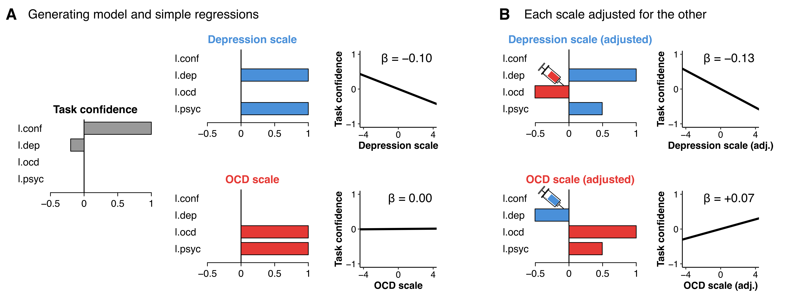

# Controlling for covariates can inject, not just remove, unintended content into the variable of interest

Noam Sarna, Jeanette Mumford, Reuven Dar & Matan Mazor

This repository contains the code for the simulation and Figure 1.

## Usage

Run `content_injection_sim.R` in R. 
The script prints the stats reported in the text and the values shown in Figure 1
